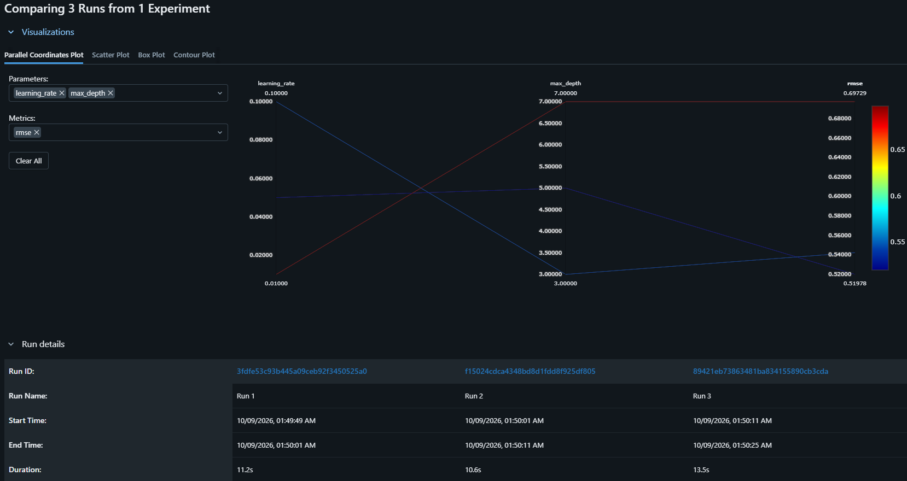
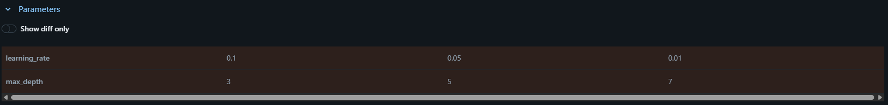
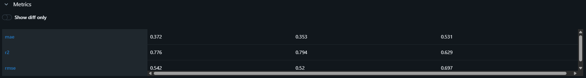

# MLflow Experiment Tracking: California Housing

## Description
This project uses MLflow to track and compare three runs of the same model on the California Housing dataset. The model is a `GradientBoostingRegressor`. Each run uses a different `max_depth` and `learning_rate`. MLflow records the parameters, the validation metrics (RMSE, MAE, R²) and the trained model for each run. RMSE is the primary metric for choosing the best model.

## How to Run
```bash
pip install -r requirements.txt
python train.py
mlflow ui --backend-store-uri sqlite:///mlflow.db
```
Then open http://127.0.0.1:5000 and go to **Training runs** in the *California Housing* experiment.

## Setup
- Dataset: California Housing (scikit-learn)
- Split: 80% training / 20% validation (`random_state=42`)
- Model: `GradientBoostingRegressor` (other settings left at default, `random_state=42`)

## MLflow Results


*Figure 1: MLflow parallel coordinates plot comparing the three runs. Each line is one run, tracing its learning rate and max depth through to its validation RMSE. The red line (Run 3: depth 7, learning rate 0.01) ends highest at about 0.697, so it performed worst. The two blue lines (Run 1 and Run 2) end much lower, and Run 2 (depth 5, learning rate 0.05) ends lowest at about 0.520, making it the best model.*


*Figure 2: Hyperparameters used in each run. Max depth increases from 3 to 7 across the runs while the learning rate decreases from 0.1 to 0.01. Everything else (data split, seed, number of trees) was kept the same, so the differences in results come only from these two settings.*


*Figure 3: Validation metrics for each run. Run 2 has the lowest RMSE (0.520) and MAE (0.353) and the highest R² (0.794), so it is the best on all three metrics. Run 3 is the worst, with an RMSE of 0.697 and an R² of 0.629.*

## Comparison Table

| Run | Max Depth | Learning Rate | RMSE | MAE | R² |
|-----|-----------|---------------|--------|--------|--------|
| Run 1 | 3 | 0.1 | 0.5422 | 0.3716 | 0.7756 |
| **Run 2** | **5** | **0.05** | **0.5198** | **0.3531** | **0.7938** |
| Run 3 | 7 | 0.01 | 0.6973 | 0.5311 | 0.6290 |

## Selected Best Model
**Run 2** (max_depth = 5, learning_rate = 0.05), with the lowest RMSE of 0.5198.

## Why Run 2
- It has the lowest RMSE, which was the selection metric. It is also the best on MAE and R², so the choice is not close.
- Run 1 uses shallow trees (depth 3), which limits how much the model can learn.
- Run 3 has a very small learning rate (0.01) with the default 100 trees, so it does not finish learning and underfits. Its deeper trees do not make up for this.
- Run 2 sits between the two: trees deep enough to capture the patterns, with a learning rate that still converges.
- Note: depth and learning rate changed together between runs, so these results show which configuration works best but cannot separate the effect of each setting.